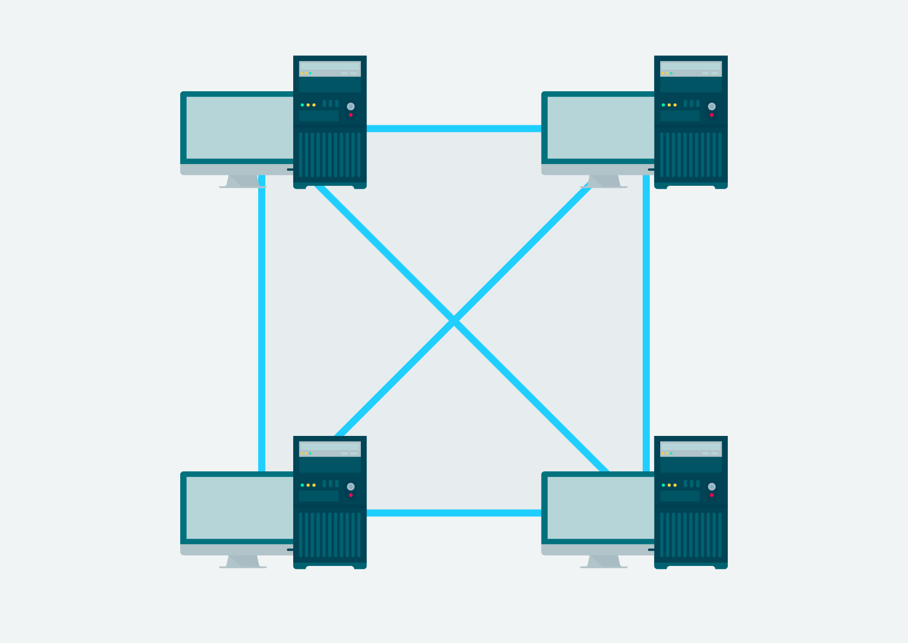

# Basic Networking Concepts

## Key Concepts

- A network is a collection of computing devices that can communicate with each other

- Some benefits of Networking are resource sharing, ease of communication, and internet access.

- There are 2 basic types of computer networks: Peer-to-Peer networks and Client-Server network

## Peer-to-Peer Networks

In a P2P network, each computer acts as a server, each equally being able to provide data

Some advantages of establishing a P2P network are:

- They're easy to install and configure
- Don't require a dedicated server or administrator
- Don't require additional equipment or software to operate

These advantages make P2P networks ideal for sharing resources among a small group of users, however, they also come with some disadvantages which are:

- Computers who share resources can possibly face reduced performance
- No centralised organisation to manage access to data
- Security applies to a single resource at a time e.g. one login per resource

## Client-Server Network

In a Client-Server network, one computer is established as the server, responding to requests from other machines i.e. clients, in the network. An example of this, is any website, websites are typically hosted on web servers - A web browser acts as the client that requests data from the server, with the server responding and sending the webpage data back.

A Client-Server Network inverts the disadvantages of P2P Networks, by offering greater control over data and only requiring a single network login to access different resources.

This type of network is not without its own disadvantages however, the centralised aspect of it can also be detrimental. This is because a single server failure, could render a network unstable, which in turn, causes a loss of network resources. Client-Server networks also require dedicated hardware and specialised software, making them a more expensive option relative to P2P Networks.

## Local and Wide Area Networks

- These titles are used to categorise networks according to their scale
- Local Area Networks (LAN), are one of the most common, and are typically within a single building or site
- Wide Area Networks (WAN), are essentially a collection of LANs, and are used to connect computers over a greater distance

## Network Topologies

- A network topology describes how computers and devices in a network are linked together
- There are 4 main network topologies which are: Bus, Star, Ring, Mesh

**Bus Networks** were typically used in early networking, with a single cable connecting each device to the network. A major risk of this topology is that a single computer failure or cable damage can bring down the entire network.

**Star Networks** are common in modern networking, where each computer is connected to a central device, such as a hub, switch, router. This offers more resilience relative to Bus Networks, as the failure of one device does not disrupt the entire network.

**Ring Networks** consist of each computer being connected to others in a closed loop. This type of network can be resilient if data can travel in both directions as it means that if a single failure occurs, data can still travel in the other direction. 

**Mesh Networks** are used for critical operations where minimising downtime is a priority. Each computer is connected to every other computer without a central connecting device.

## Network Components

Networks are made up of components that work together to facilitate communication and data exchange between devices. Networks are typically made up of the following components: Devices, Media, Networking Hardware, Protocols and Services.

### Devices

**Devices** are generally split into 2 categories, **Endpoints/end-user** devices and **Intermediate/Intermediary** Devices.

**Endpoints** are devices that connect to a computer network and serve as sources or destinations of data so they are significantly important to the overall functionality of the network. Some common types of **endpoints** are:

- Desktops and laptops
- Servers such as file servers, web servers, and database servers.
- Mobile devices such as smartphones and tablets

**Intermediary** devices facilitate the communication and data exchange. They manage and secure traffic by directing data between different devices. Some common types of these devices are:

- Switches connect devices within the same network, enabling efficient data exchange
- Routers connect different networks together, such as connecting a local network to the internet
- Wireless Access Points (WAP) and controllers (WLC) allow wireless devices to communicate with each other and facilitate communication with wired networks

### Media

**Media** refers to the method itself of connecting devices together. There are 2 main types of this, which are:

- Cables (Ethernet, Fibre Optic), with the different types of cables being used to transmit data at various speeds and distances
- Wireless (Wi-Fi, Bluetooth), where radio waves or other wireless technologies are used to transmit data

### Networking Hardware

